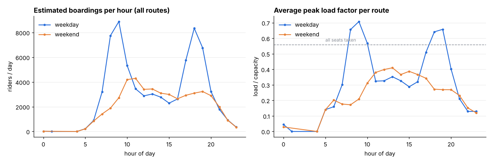
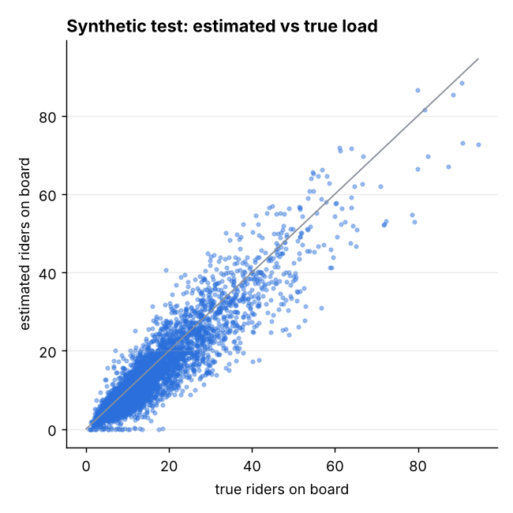

# SeatSense validation report (SYNTHETIC sample data, not real Delhi results)

## 1. Data coverage

- Tickets read: **71,327** (2026-10-05 to 2026-10-19), valid 71,327
- Share of tickets with an alighting stop: **97%**
- Ticket routes matched to GTFS: **12 / 12** (100% of tickets)
- Stop names matched: 116 / 116 {'name': 116}
- Tickets used in the model: **71,327** (100%); oriented by real alighting stop: 97%
- Route-directions with crowding estimates: **12**
- Service days: {'weekday': 10, 'weekend': 4}; scale = **12.50 riders per ticket**; capacity 38 seats + 30 standing

## 2. Peak and off-peak patterns

- Weekday morning peak hour: **9:00** (avg peak load factor 0.71)
- Weekday evening peak hour: **19:00** (avg peak load factor 0.66)
- Midday off-peak average: 0.32 -> peak/off-peak ratio **2.19x**
- Weekend average load factor 0.25 vs weekday 0.33

## 3. Most crowded route-hours

| Route | Day | Hour | Peak load factor | Seat chance at busiest stop | Busiest stop |
|---|---|---|---|---|---|
| 101 | weekday | 09:00 | 1.30 | 13% | Ashram Chowk |
| 423 | weekday | 19:00 | 0.97 | 21% | Dhaula Kuan |
| 340 | weekday | 09:00 | 0.86 | 25% | AIIMS |
| 101 | weekend | 12:00 | 0.85 | 26% | Nehru Place Terminal |
| 511 | weekday | 09:00 | 0.68 | 38% | Connaught Place |
| 205 | weekday | 09:00 | 0.66 | 39% | Sarai Kale Khan ISBT |
| 340 | weekend | 16:00 | 0.57 | 49% | Hauz Khas |
| 423 | weekend | 17:00 | 0.51 | 58% | Rajouri Garden |
| 511 | weekend | 11:00 | 0.46 | 66% | Connaught Place |
| 205 | weekend | 15:00 | 0.44 | 70% | Sarai Kale Khan ISBT |
| 764 | weekday | 19:00 | 0.41 | 76% | Lajpat Nagar |
| 764 | weekend | 13:00 | 0.28 | 97% | Nehru Place Terminal |

## 4. Spot checks against known patterns

| Route | Day | Hour | Expected | Model peak load factor | Model says | Match |
|---|---|---|---|---|---|---|
| 101 | weekday | 09:00 | crowded | 1.30 | crowded | yes |
| 101 | weekday | 14:00 | not crowded | 0.52 | not crowded | yes |
| 340 | weekday | 18:00 | crowded | 0.83 | crowded | yes |
| 764 | weekday | 09:00 | not crowded | 0.31 | not crowded | yes |
| 101 | weekend | 07:00 | not crowded | 0.26 | not crowded | yes |

**5/5 spot checks agree.**

## 5. Recovery test on synthetic data (known ground truth)

- Stop-hour cells compared: 3,764
- Mean absolute error: **3.7 riders** (mean true load 17.1)
- Correlation: **0.92**

