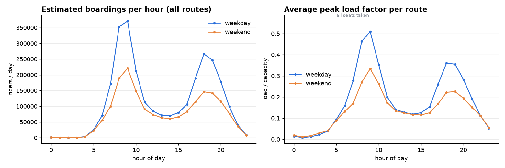

# SeatSense validation report

## 1. Data coverage

- Tickets read: **2,559,899** (2026-10-01 to 2026-10-31), valid 2,559,899
- Share of tickets with an alighting stop: **100%**
- Ticket routes matched to GTFS: **2025 / 2259** (99% of tickets)
- Stop names matched: 53538 / 65598 {'name': 43143, 'fuzzy': 10395}
- Tickets used in the model: **2,065,585** (81%); oriented by real alighting stop: 84%
- Route-directions with crowding estimates: **2508**
- Service days: {'weekday': 21, 'weekend': 11}; scale = **47.41 riders per ticket**; capacity 38 seats + 30 standing

## 2. Peak and off-peak patterns

- Weekday morning peak hour: **9:00** (avg peak load factor 0.51)
- Weekday evening peak hour: **18:00** (avg peak load factor 0.36)
- Midday off-peak average: 0.13 -> peak/off-peak ratio **3.98x**
- Weekend average load factor 0.14 vs weekday 0.18

## 3. Most crowded route-hours

| Route | Day | Hour | Peak load factor | Seat chance at busiest stop | Busiest stop |
|---|---|---|---|---|---|
| 858DOWN | weekday | 08:00 | 1.50 | 8% | Samalkha Village |
| 981UP | weekday | 07:00 | 1.50 | 7% | Kanjhawala Depot (Narela Road) |
| 463DOWN | weekday | 20:00 | 1.50 | 10% | Saket Crossing |
| 605DOWN | weekday | 09:00 | 1.50 | 7% | IIT Gate |
| 991DOWN | weekday | 09:00 | 1.50 | 8% | Nangloi Depot  / Jwala Puri |
| 588UP | weekday | 09:00 | 1.50 | 10% | Tihar Jail |
| 588DOWN | weekday | 09:00 | 1.50 | 9% | Raj Rif Line |
| 460DOWN | weekday | 08:00 | 1.50 | 7% | Ali Village |
| 465AUP | weekday | 20:00 | 1.50 | 10% | Sukhdev Vihar Depot |
| 460DOWN | weekend | 05:00 | 1.50 | 9% | Mata Mandir New Friends Colony |
| 872DOWN | weekend | 08:00 | 1.50 | 11% | Kakrola Bridge |
| 981DOWN | weekday | 19:00 | 1.50 | 8% | Ghevra Village |
| 991STLDOWN | weekday | 09:00 | 1.50 | 9% | Nangloi Depot  / Jwala Puri |
| 569DOWN | weekday | 08:00 | 1.50 | 10% | Rajouri Garden Ring Road |
| 991UP | weekday | 19:00 | 1.50 | 6% | Shivaji Park |
